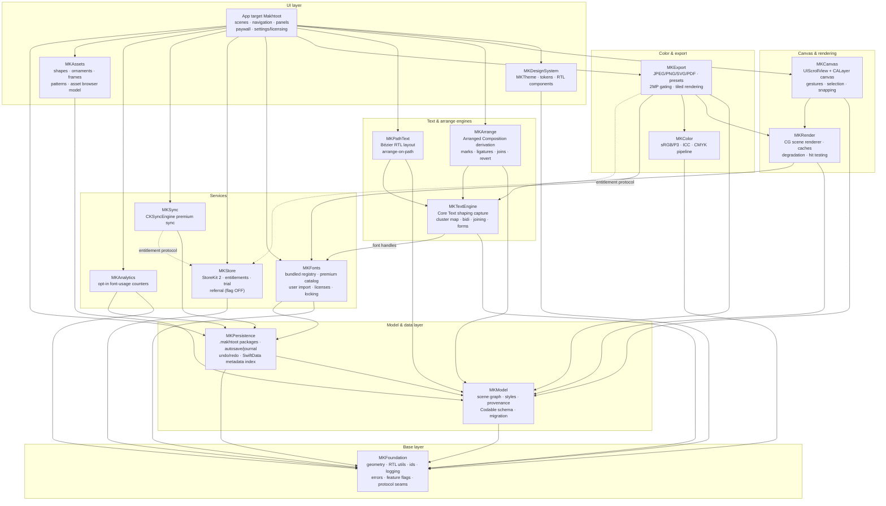
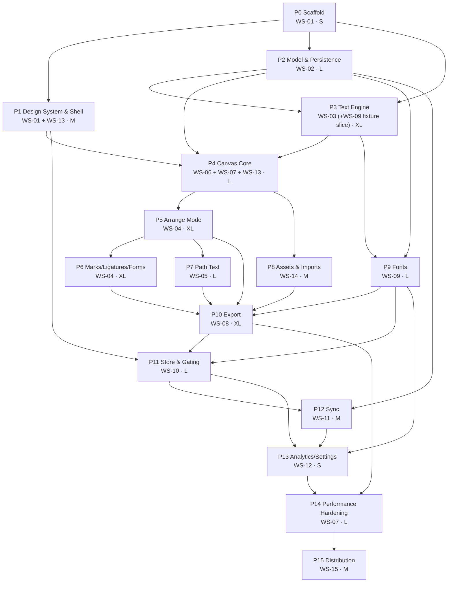

# Makhtoot (مخطوط) — DEPENDENCY_GRAPH.md
## Implementation-Order Rationale (Run 1)

This document explains *why* the build order in PLAN.md is what it is. It renders
the module-dependency structure of FOUNDATION §2, the phase/workstream ordering of
FOUNDATION §11 as implemented by PLAN.md, a written topological order with a
rationale paragraph per dependency edge, a parallelization map for Run-3
concurrent agent execution, and the stub strategy that lets downstream work start
before its upstream subsystem is complete. Decision references are D-1xx /
FD-0x (FOUNDATION); requirement references are BRIEF.md bullets. Conventions per
FOUNDATION §12.

Two kinds of edges appear here and must not be confused:

- **Module edges** (compile-time): "target A imports target B" exactly as
  declared in FOUNDATION §2. These are permanent and mechanically enforced by
  SPM from P0 onward (PLAN P0).
- **Phase edges** (build-order): "phase X must reach its exit gate before phase
  Y starts (or starts a specific slice)." These are scheduling facts, softened
  where stubs (§5) deliberately decouple them from module edges.

---

## 1. Module dependency graph (FOUNDATION §2)



Dashed edges are **protocol edges** (D-113/D-119 consumers): MKExport and MKSync
never import MKStore's concrete resolver; they depend on the
`MKEntitlementProviding` protocol declared in MKFoundation, with MKStore
supplying the production implementation and stubs supplying it earlier (§5).
This is what makes the store buildable *last* among service dependencies while
its consumers are built *earlier*.

## 2. Phase / workstream ordering graph (FOUNDATION §11 · PLAN.md)



Reading note: edges into P10 from P6/P7/P8 are *content-completeness* edges (the
export matrix must cover every node type), while P5→P10 is the *hard* edge
(arranged content is the reason SVG/PDF provenance output exists at all). PLAN
§2 P10 entry criteria state this: P5 minimum, others folded in as they land.

---

## 3. Topological order with per-edge rationale

### 3.1 Module topological order

A valid compile order (ties broken by build value):

```
MKFoundation → MKModel → { MKDesignSystem, MKColor, MKStore } →
MKPersistence → MKFonts → MKTextEngine → MKRender →
{ MKArrange, MKPathText, MKCanvas, MKAssets, MKAnalytics } →
{ MKExport, MKSync } → App target
```

Note the deliberate divergence between compile order and *build-effort* order:
MKFonts compiles before MKTextEngine (module edge), yet the fonts *subsystem* is
phase P9 while the text engine is phase P3. The reconciliation is that P3 needs
only the thin `MKFontProviding` slice of MKFonts (fixture registration), not the
catalog/download/import/locking mass — see edge E-F1 and §5.

### 3.2 Module-edge rationales

**E-M1 · MKModel → MKFoundation.** The scene graph is expressed in MKFoundation's
geometry and transform value types (decomposed position/rotation/scale, D-111)
and its id/error primitives. Putting geometry beneath the model rather than
inside it lets MKRender, MKCanvas, and MKPathText share the same math without
importing the whole model, and keeps D-102's Sendable value-type discipline
anchored in one place.

**E-M2 · MKPersistence → MKModel (and MKFoundation).** Persistence serializes the
scene graph, so the Codable schema (D-111/D-112) must exist first; the direction
matters because the model must never know *how* it is stored (file package vs
CloudKit record are both consumers of the same Codable form). This edge is why
PLAN builds model+persistence as a single phase (P2): a schema without a proven
round-trip and crash-recovery story is not "done," and every later phase (arrange
provenance, export history, font catalog state) writes through this layer.
**Model+persistence strictly before canvas** — the canvas (P4) mutates scenes via
the undo/redo command stack and triggers autosave on every gesture; building
interaction before the mutation/persistence substrate would force a rewrite of
every gesture handler when the command stack lands.

**E-F1 · MKTextEngine → MKFonts ("font handles").** Shaping capture needs
concrete `CTFont` handles for registered fonts — the engine cannot shape with a
font name string, and D-107's ZWJ form harvest must run in the *same* font as
the target run. The compile-time edge points engine→fonts, but the phase-time
resolution is the reverse of naïve reading: P3 uses a **fixture strategy**, not
the full P9 subsystem. Rationale: (a) the two pre-verified OFL fonts (Amiri,
Noto Naskh Arabic — BRIEF "market study §5 verified so far") are sufficient to
prove every engine invariant; (b) waiting for the full 20-font D-120
verification program would serialize the program's largest risk (P3) behind its
most clerical work (license capture); (c) conversely, running the full catalog
*before* the engine exists would verify fonts nobody can render-test. So: a
minimal, real (not fake) registration path lands in P3 via the P0
`MKFontProviding` seam, and P9 later replaces the provider and re-runs the P3
fixture suite across the entire verified set (PLAN P9 exit criteria). This is
the "fonts before text-engine bring-up fixtures vs stub strategy" resolution:
fixtures use *real verified fonts through a stub-shaped provider*, never mock
glyph data — mock shaping data would invalidate the entire point of P3.

**E-A1 · MKArrange → MKTextEngine.** Arrange derivation (D-106) is a *consumer
of shaped output*: glyph ids, positions, advances, joining state, cluster maps,
mark offsets all originate in the engine's capture structures. The engine
strictly precedes arrange because every arrange defect must be attributable —
either capture is wrong (P3 bug) or derivation is wrong (P5 bug); building both
at once would create an undebuggable blame surface for the product's core
differentiator. **Text engine strictly before arrange UI** is the single most
important ordering rule in the program.

**E-A2 · MKArrange → MKModel.** Arranged Compositions are persisted scene nodes
with provenance (D-111 arranged children). The node *schema* is landed in P2 —
before any producer exists — precisely so the P5 producer targets a stable,
round-trip-tested Codable contract instead of co-evolving schema and derivation
logic (schema churn during P5 would put Source Text Backup integrity, i.e. the
revert guarantee, at risk).

**E-P1 · MKPathText → MKTextEngine, MKModel.** Path layout re-uses shaped runs
(advances drive arc-length pen movement, D-110) and produces the same node
types. It sits beside MKArrange, not above or below it: P7 needs P5's
*derivation pipeline* (arrange-on-path freezes through the same code path —
PLAN P7 entry) but is independent of P6's mark/ligature surgery, which is why
P7 ∥ P6 in the parallelization map.

**E-R1 · MKRender → MKTextEngine.** The renderer draws Live Text through engine
capture so that canvas preview and export are pixel-identical (D-104, D-118:
"single render path... never screen capture"). If the canvas rendered text via
UIKit labels while export rendered via the engine, every G-ARABIC checklist item
would need double verification and WYSIWYG would be a hope, not an invariant.
This edge is why **text engine also strictly precedes export**: MKExport draws
through MKRender, so shaped-capture correctness is upstream of every artifact
the user ever takes out of the app.

**E-R2 · MKCanvas → MKRender (and MKModel).** The canvas is interaction over a
renderer: gestures produce model mutations; the renderer turns snapshots into
layers; hit-testing geometry lives with rendering because it must agree with
what was drawn (D-114). Direction matters: MKRender must not know about
gestures or selection so that MKExport can drive it headlessly.

**E-X1 · MKExport → MKRender, MKModel.** Export is "render a snapshot to bytes"
— it reuses the exact drawing code (E-R1 rationale) with tiled bitmap contexts
(D-118) instead of layer contents. Export cannot precede a working renderer,
and scheduling it after P5 (not merely P4) is deliberate: the hardest export
promises (SVG editability with `data-mk-*` provenance, per-feature outline
fallbacks — Q73/D-118) are *about arranged content*, so exporting before
arrange exists would validate only the easy half of the matrix.

**E-X2 · MKExport → MKColor.** The CMYK/ICC pipeline (D-117, Q75) is
export-only in v1 (no on-screen soft-proofing), but it is a separate target
because color conversion must be unit-testable without rendering a document,
and because FD-03 (profile election) may swap the profile without touching the
export writers. MKColor has no upstream except MKFoundation, so it can be
built any time; PLAN co-locates it with P10 because its only consumer arrives
there.

**E-X3 · MKExport → MKFonts.** The PDF/SVG writers make per-font legal
decisions — subset-embed vs outline is a license switch (D-118), and premium
font expiry-locking blocks re-export at free tier (D-119/Q27). Export therefore
needs the fonts subsystem's license metadata, which is why P9 sits before/
parallel-into P10 and why P10's exit criteria include license-driven embed
behavior. The *effort* rationale: font licensing evidence (P9) maturing first
means P10 never ships a writer whose legal switch has no data to read.

**E-X4 · MKExport ⇢ MKStore (protocol edge).** Export gating (free 2 MP
JPEG/PDF vs premium matrix, D-118/D-119) is an entitlement *query*, not a
StoreKit dependency. The protocol edge lets the full free/premium branch logic
be implemented and unit-tested in P10 against fake providers (always-premium,
always-free), while real StoreKit arrives in P11. **Store before gating
enforcement** (P11 flips the stub and sweeps every touchpoint), **but paywall
UI after design system** (the paywall is a P1-component consumer; building it
before MKDesignSystem existed would hard-code styling that FD-02 re-theming
would then break — hence paywall *route* in P1, paywall *content* in P11).

**E-S1 · MKFonts → MKPersistence.** Catalog state, favorites, download state,
imported-font records, and expiry-lock flags live in the SwiftData metadata
index (D-112 list), and imported font files are content-addressed into managed
storage (D-122). Fonts therefore build on persistence — one more reason P2
precedes both P3 (via fixture slice) and P9.

**E-S2 · MKSync → MKPersistence (+ MKStore protocol).** Sync ships whole
`.makhtoot` packages as CKRecord payloads (D-112 CloudKit clause); it is a
replication layer over the document store, not a second store — so the store's
atomicity/journaling must be finished and stable long before sync reads it
(P2 → P12 is the longest-soaking edge in the program, intentionally: sync should
replicate a format that has stopped moving). The protocol edge to MKStore is
the premium gate (BRIEF: premium/lifetime iCloud sync), which is why P12
follows P11 — sync is the one consumer where the always-premium stub would be
actively dangerous (it could upload free users' data to a tier they don't
have), so PLAN never enables MKSync wiring until real entitlements exist.

**E-S3 · MKAnalytics → MKPersistence.** Consent records (versioned) and
font-usage counter buckets are metadata-store rows (D-112, D-125). The seam
(`MKAnalyticsRecording`, P0) is no-op until P13 so earlier phases can emit
usage events without any privacy surface existing yet — recording anything
before consent UI exists would violate the opt-in-only posture (Q43/Q79).

**E-U1 · MKDesignSystem → MKFoundation; App → everything.** The design system
sits on foundation only (tokens are value types; no model knowledge), so P1 can
run parallel to P2/P3. The app target is the integration point and appears in
every phase; its per-phase slices are governed by the phase edges, not by a
single "UI phase."

**E-U2 · MKAssets → MKModel.** Bundled assets are scene-node factories (shape/
image nodes), needing the model but not the engine — asset work (P8) is
therefore parallelizable against P5–P7 and gated only by canvas placement
existing (P4).

### 3.3 Phase-edge rationales (where not already implied above)

**P0 → {P1, P2, P3}.** The scaffold's protocol seams (§5) and mechanically
enforced module boundaries are what make the following three-way fork safe:
after P0, three agents can work without file overlap (design system / model+
persistence / engine spike). Nothing before P0 exists, by definition.

**P2 → P3 (soft), P3 → P4 (hard).** The engine can begin against MKFoundation
alone (capture structures are self-contained), but its provenance structs
finalize against MKModel types late in P3 — hence "soft": start P3 when P0
exits, finish P3 after P2 exits. P4 is hard-gated on both: the canvas renders
engine output (E-R1) and persists via P2 (E-M2). PLAN's M3/M4 milestones
encode exactly this join.

**P4 → P5 → P6, P5 → P7.** Arrange manipulates canvas objects, so interaction
substrate precedes it. The P5/P6 split (derivation + whole-glyph manipulation,
then sub-structure surgery) exists because P6's operations are *destructive
transformations over P5's data model* — decompose/recompose and join-break are
only testable once derivation fidelity is trusted (G-ARABIC arrange section
green at M5). P7 branches off P5, not P6 (E-P1).

**{P3, P2} → P9.** Fonts need the engine for preview rendering and
fixture-compat testing (the P9 exit re-runs P3's suite per font), and
persistence for catalog state (E-S1). P9 deliberately does *not* wait for
P5–P7: license verification (WS-09 protocol) is engine-independent clerical
work that parallelizes perfectly against arrange development.

**{P5..P9} → P10 → P11 → P12 → P13.** The service tail is serial for reasons
stated at E-X1..E-X4, E-S2: export needs all content types and font licenses;
store flips export's stub and enforces gating everywhere; sync needs real
entitlements; analytics/settings closes last because its licensing screen
mirrors the finished P9 evidence pack and its settings surface embeds P11/P12
toggles. P13 is small (S) precisely because everything it surfaces already
exists.

**{P10, P13} → P14 → P15.** Hardening profiles the feature-complete app (a
perf pass over a moving feature set measures nothing durable), and export is
its heaviest scenario class (tiled 4K+, D-116 interplay). Distribution is last
by definition and additionally hard-gated on FD-01/FD-06 and the
placeholder-identifier sweep (PLAN §2 P15, §3 items 5–6).

---

## 4. Parallelization map (Run-3 concurrency)

Concurrency boundaries are module boundaries (D-101 targets): two agents never
hold in-flight edits in the same target. App-target UI slices are partitioned
by scene (browser / editor / settings / paywall) to keep this true.

| Window (after milestone) | Concurrent tracks | Serial constraint active |
|---|---|---|
| After M0 (P0) | **T1:** P1 WS-01/WS-13 (design system + shell) · **T2:** P2 WS-02 (model+persistence) · **T3:** P3 WS-03 early spike (capture structures, fixture harness on MKFoundation types) | P3 cannot *finish* until P2 exits (provenance types) |
| After M2 (P2) | **T2 joins T3:** P3 completes with real model types · **T1:** P1 finishing, browser wired to real documents | P4 blocked until both P1+P3 exit |
| After M3+M1 | Single-track **P4** (WS-06/WS-07/WS-13 editor chrome) — the join phase; all agents converge on canvas bring-up (MKCanvas, MKRender, app-editor slices are three agent lanes inside one phase) | P5 blocked on P4 exit |
| After M4 (P4) | **T1:** P5 WS-04 (arrange) · **T2:** P8 WS-14 (assets/imports) · **T3:** P9 WS-09 (font verification + catalog; engine-dependent preview work starts immediately, per-font fixture re-runs as fonts clear verification) | P10 blocked on P5 (hard) |
| After M5 (P5) | **T1:** P6 WS-04 (marks/ligatures/forms) · **T2:** P7 WS-05 (path text) · **T3:** P9 continuing · **T4:** P10 WS-08 early (MKColor pipeline; JPEG/PNG/tiling writers against P5 content; fake-entitlement branch tests) | P10 *exit* needs P6/P7/P8/P9 content folded in |
| After M6+M7+M8+M9 | Single-track **P10 completion** (SVG/PDF writers over full content matrix, CMYK QA → FD-03 pause) | P11 blocked on P10 exit |
| After M10 (P10) | Single-track **P11** WS-10 (stub flip is app-wide — no safe concurrency during the gating sweep) | P12/P13 blocked |
| After M11 (P11) | **T1:** P12 WS-11 (sync) · **T2:** P13 WS-12 (analytics/settings, licensing screen) — disjoint targets, both small | P14 waits for both |
| After M12+M13 | Single-track **P14** WS-07 (hardening; feature freeze makes concurrency moot — profiling lanes per device class run in parallel as *tasks*, not code tracks) | P15 blocked |
| After M14 (P14) | Single-track **P15** WS-15 with founder-pause checkpoints (FD-01, FD-06, credentials, final approval) | — |

Maximum useful width is 4 agent tracks (window after M5); the program's median
width is 2–3. Widening further has no payoff: the spine phases (P4, P10-close,
P11, P14, P15) are intentionally single-track because they are join points
(P4), whole-app sweeps (P11), or evidence-gathering passes (P14, P15) where
parallel code motion would corrupt the measurement or the sweep.

---

## 5. Stub strategy

Stubs exist to break the phase-order coupling that module edges would otherwise
impose, without ever faking the thing being tested. Rules: (1) every stub is a
protocol declared in `MKFoundation` at P0; (2) production and stub conformances
are swapped at the app-target composition root only — no feature code ever
mentions a stub type; (3) each stub has a named flip phase and a flip
verification task in TEST_MATRIX; (4) stubs never fake *the subject under test*
(shaping fixtures use real fonts; gating tests use fake entitlements — never
the reverse).

**S1 · `MKEntitlementProviding` — stubbed `AlwaysPremiumEntitlements`, P0–P10;
flipped in P11.** Consumers: MKExport (format/resolution gating, D-118/D-119),
MKFonts (premium catalog download, import gate, expiry locking), app UI
(paywall triggers, premium badges), MKSync (never wired to the stub — see
E-S2). During P4–P10 the whole team builds and dogfoods at full capability
(matching BRIEF "No artificial premium caps" engineering posture), while every
gating branch is still *written* and unit-tested against a second fake
(`AlwaysFreeEntitlements`) so P11's flip is a wiring change plus a sweep, not a
feature build. Flip verification: PLAN P11 gating-sweep checklist, both
directions (no leak at free, no false lock at lifetime).

**S2 · `MKFontProviding` — system-font + fixture registration slice, P0–P3;
replaced by MKFonts registry in P9.** Consumers: MKTextEngine (font handles),
MKRender (drawing), MKDesignSystem previews. The stub registers the two
pre-verified fixture fonts via the same
`CTFontManagerRegisterFontURLs(.process)` call the real registry uses
(D-122, amended by D-219) — the *mechanism* is production-real from P3; what's stubbed is the
catalog around it (no download, no import, no locking, no metadata). Flip
verification: P9 re-runs the entire P3 golden-fixture suite across the full
verified set; any font failing engine fixtures is excluded (catalog gate), not
worked around in the engine.

**S3 · `MKAnalyticsRecording` — no-op recorder, P0–P12; real recorder behind
consent in P13.** Consumers: MKFonts (usage counters), app UI. The no-op keeps
call sites honest from the start (P9 code emits usage events into the void) so
P13 does not retrofit instrumentation; privacy posture is preserved because
nothing is recorded anywhere until the consent-gated implementation exists
(D-125, Q43/Q79). Flip verification: consent-off = zero traffic network
evidence (PLAN P13 exit).

**S4 · Memory-pressure ladder actions — sources wired in P0, stage actions
stubbed to logging until their substrates exist.** Stage autosave actions
become real in P2 (journal flush), cache-drop actions in P4 (MKRender caches),
degradation actions in P4/P14 (half-res bitmaps). D-116 is thus *observable*
from the first build and *enforced* incrementally; P14 proves the full ladder
end-to-end 10/10.

**S5 · Referral module — permanently flag-stubbed.** Not a development stub:
`MKStore/Referral` compiles inert behind `MKFeatureFlags.referralProgram = OFF`
(D-124) and has no flip phase in v1 (FD-05 only). Listed here so Run 3 treats
it as a stub that must *stay* stubbed — its verification task is proving
inertness, and Run 2 is asked (PLAN §4 item 12) to challenge whether
compiled-inert vs compiled-out is the right posture.

**Deliberately NOT stubbed:** MKTextEngine (nothing downstream may proceed on
fake shaped data — E-A1/E-R1 rationale; a mock engine would let canvas/arrange
"work" against geometry the real engine will never produce), MKPersistence
(feature code writing to a fake store would hide autosave-latency and atomicity
constraints that shape API design, D-112), and MKRender (a placeholder renderer
would decouple canvas from the pixel-identical-export invariant, D-104/D-118).
These three are the spine; the schedule protects them with early phases instead
of stubs.

---

## 6. Traceability

| This document's element | BRIEF.md bullet(s) | FOUNDATION id(s) |
|---|---|---|
| Module graph nodes/edges (mermaid §1) | Engineering (SwiftUI-first, custom layer atop Apple shaping) | §2 module table, D-101 |
| Protocol (dashed) edges | Monetization (gating); Canvas & projects (premium sync) | D-113, D-119, §2 "(protocol)" notes |
| Phase graph (mermaid §2) | Run 1 deliverables (PLAN phases) | §11 P0–P15, WS-01..WS-15 |
| E-M2: model+persistence before canvas | Canvas & projects (undo/redo, autosave); Performance (no-loss recovery) | D-111, D-112, D-116 |
| E-F1: fonts-vs-engine fixture resolution | Fonts & licensing (verified Amiri/Noto; never invent licenses) | D-103, D-107, D-120, D-122 |
| E-A1: engine strictly before arrange UI | Arabic text & glyph engine (Arrange Mode derivation) | D-105, D-106 |
| E-R1/E-X1: engine before export, single render path | Export (verify sharp Arabic output; canvas/export identical) | D-104, D-114, D-118 |
| E-X2/FD-03 CMYK isolation | Export (true CMYK, ICC-aware — Q75) | D-117, FD-03 |
| E-X3: fonts before export legal switches | Export (SVG editability Q73; embedding per license); Fonts (expiry Q27) | D-118, D-119, D-121 |
| E-X4: store before gating, paywall after design system | Monetization (free tier Q41; paywall compliance) | D-113, D-119, D-126 |
| E-S2: sync after store, over stable persistence | Canvas & projects (premium iCloud sync); Accounts (Q77, CloudKit not SIWA) | D-112 sync clause |
| E-S3/S3: analytics opt-in only | Accounts, data, privacy (Q43, Q79) | D-125 |
| Parallelization map | Engineering (codebase-memory conventions Q58; tooling Q49) | §11 workstreams, D-101 |
| Stub strategy S1 (always-premium until P11) | Monetization (post-trial gating; expiry Q27) | D-113, D-119 |
| Stub strategy S2 (fixture fonts) | Fonts & licensing (bundled starter, formats) | D-120, D-122 |
| Stub strategy S4 (pressure ladder) | Performance (memory-pressure monitoring, autosave) | D-116 |
| Stub strategy S5 (referral stays OFF) | Monetization (referral Q78, default OFF) | D-124, FD-05 |
| Not-stubbed spine | Arabic engine (differentiator); Performance | D-103, D-104, D-105, D-112, D-118 |
