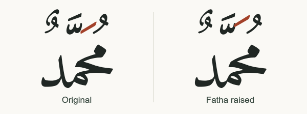

# Makhtoot · مخطوط

Makhtoot is an Arabic typography editor for iPhone and iPad. Type a phrase such as **مُحَمَّدٌ**, choose a font, then enter **الترتيب الحر** (Arrange Mode) to move a letter or diacritic within the composition. The editor keeps the original text so you can return to ordinary editing. All implemented features are free to use, including font and image import, PNG, SVG and print PDF export, and optional iCloud project sync.

[ابدأ بأول تصميم على الآيفون أو الآيباد](docs/quick-start.ar.md) · [Build from source](docs/BUILD.md) · [Contribute](CONTRIBUTING.md)

The highlighted fatha is the only mark that moves in this illustration. [Editable example and illustration notes](examples/README.md)

## What you can work on

| Platform | What is in this repository |
| --- | --- |
| iPhone and iPad | The SwiftUI app, the Core Text shaping engine, the canvas and exporters. The deployment target is iOS 18. Start with the simulator instructions in the build guide. |
| Android | A Kotlin/Gradle port in progress, native HarfBuzz and FreeType code, and reference fixtures. Several editor and persistence operations are stubs. The app manifest has no launcher activity. The port follows the same free-access policy. Start with the focused JVM check in the build guide. |

## Find your way around

| I want to… | Start here |
| --- | --- |
| Make and export a first design | [Arabic walkthrough](docs/quick-start.ar.md) |
| Understand how a letter reaches the canvas or an export | [Architecture guide](docs/architecture-guide.md) |
| Understand a saved design or compare fixture versions | [Document format](docs/document-format.md) |
| Report a joining, mark-placement or export problem | [Typography testing guide](docs/typography-testing.md) |
| Know what stays on my device and what a fork must configure | [Privacy and services](docs/privacy-and-services.md) |
| Manage an earlier App Store subscription | [Apple Account subscriptions](https://apps.apple.com/account/subscriptions) |
| Add a font or reuse an asset | [Asset rights](docs/asset-rights.md) and [third-party notices](THIRD_PARTY_NOTICES.md) |
| Submit a patch, get help or report a vulnerability | [Contributing](CONTRIBUTING.md), [conduct](CODE_OF_CONDUCT.md), and [private security reports](SECURITY.md) |
| See project priorities and how releases are prepared | [Roadmap](docs/roadmap.md), [changes](CHANGELOG.md), and [maintainer guide](docs/maintaining.md) |

## License and forks

The **Binjamshid Public Fork License, Version 1.0** governs software the copyright holder publicly releases under it. The model is source-available. A private checkout or invitation does not authorize public disclosure. For covered releases, individuals may study, modify and share the code under the license. Commercial use for or on behalf of a for-profit organization is restricted. If you change covered code, section 4 sets publication deadlines for each version, including private edits, and an exception for coordinated vulnerability fixes. A contribution upstream is optional. [Read the full license](LICENSE).

Font families, native libraries and other separately licensed material retain their own terms. The source license grants no trademark rights. Official app distribution has separate terms. [Third-party notices](THIRD_PARTY_NOTICES.md) · [Asset rights](docs/asset-rights.md) · [App terms](docs/legal/terms.html)
